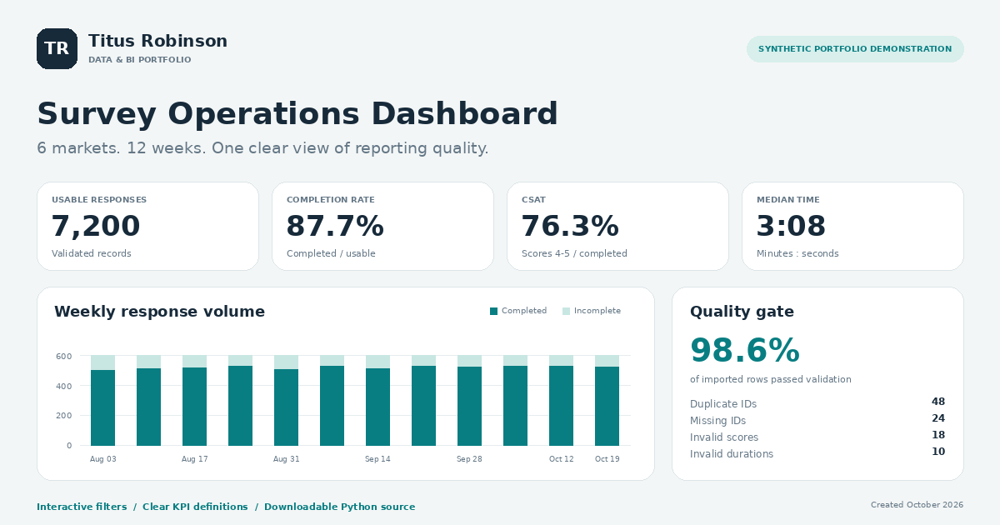
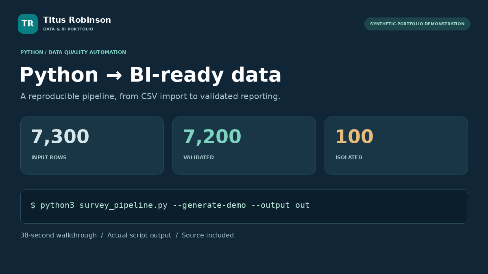

# Titus Robinson — Data & BI Portfolio

Interactive survey analytics and a reproducible Python data-quality pipeline.

**[Explore the dashboard](https://titusrobinsonone.github.io/)** · **[Watch the 38-second Python demo](https://titusrobinsonone.github.io/automation/)** · **[LinkedIn](https://www.linkedin.com/in/titusrobinson/)**

[](https://titusrobinsonone.github.io/)

## What is in this project?

- An interactive dashboard with market, channel and date filters, weekly trends, completion and satisfaction metrics, and a validation audit.
- A runnable, standard-library Python pipeline with explicit validation rules, first-valid-ID deduplication, rejected-row exports and consistent metric definitions.
- A captioned 38-second walkthrough, synthetic CSVs, sample outputs, a downloadable project bundle and a one-page dashboard PDF.

**Synthetic portfolio demonstration.** This is new demonstration work created in October 2026. All responses, identifiers and results are generated. The figures describe this example dataset and do not represent client data or measured workplace improvements.

## Example run

```bash
python3 src/survey_pipeline.py --generate-demo --output demo-output
```

Python 3.10+ is sufficient for the pipeline. No packages, API credentials or external services are required.

| Validation result | Rows |
| --- | ---: |
| Input | 7,300 |
| Validated | 7,200 |
| Isolated exceptions | 100 |

The intentional exceptions are 48 duplicate IDs, 24 missing IDs, 18 invalid satisfaction scores and 10 invalid durations. Clean rows plus rejected rows reconcile to the input count.

The valid synthetic dataset contains 6,313 completed responses: **87.68% completion**, **76.29% CSAT** and a **188-second median completion time**. Full definitions and validation rules are in [the pipeline README](src/README.md).

## Inspect the work

- [Python pipeline](src/survey_pipeline.py)
- [Focused validation tests](src/tests/test_survey_pipeline.py)
- [Actual run log](docs/assets/pipeline-run.txt)
- [Synthetic input](docs/assets/survey_raw.csv), [clean output](docs/assets/survey_clean.csv) and [rejected rows](docs/assets/survey_rejected.csv)
- [Market summaries](docs/assets/survey_summary.csv) and [quality report](docs/assets/quality-report.json)
- [Download the standalone Python project](docs/assets/survey-pipeline-project.zip)
- [Dashboard PDF](docs/assets/survey-dashboard.pdf)
- [Video file](docs/assets/python-pipeline-demo.mp4) and [English captions](docs/assets/demo-captions.vtt)

[](https://titusrobinsonone.github.io/automation/)

## Run the tests

```bash
python3 -m unittest discover -s src/tests -v
```

Six focused tests cover deduplication, metric denominators, row reconciliation, invalid inputs, source preservation and category validation.

## Run the dashboard locally

```bash
python3 -m http.server 8000 --directory docs
```

Open `http://localhost:8000/`. The dashboard loads the included pipeline JSON and recalculates KPIs for each filter selection. The quality panel always describes the full import.

## Project layout

```text
docs/             Static GitHub Pages site, media and downloadable data
src/              Python pipeline, tests and media generator
README.md         Project overview and run instructions
```

The site uses vanilla HTML, CSS and JavaScript and custom SVG charts. GitHub Pages publishes the `docs` directory from `main`; no application server is needed. Regenerating the optional PDF/video assets additionally uses Pillow, ReportLab and FFmpeg.

The video is a paced walkthrough of the included script's actual output. It is not presented as a live execution recording or a production performance benchmark.
