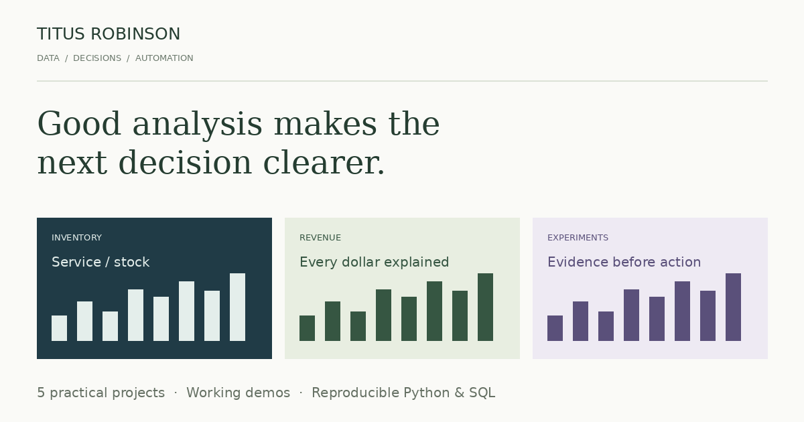

# Titus Robinson — Data, Decisions & Automation

[**Explore the portfolio →**](https://titusrobinsonone.github.io/) · [LinkedIn](https://www.linkedin.com/in/titusrobinson/) · [How to add a project](EDITING.md)

Five inspectable projects connecting a business question to runnable analysis, interactive reporting and clear limitations.

Portfolio owner and maintainer: **Titus Robinson**. These are independent, AI-assisted portfolio implementations created in October 2026. All included datasets and reported results are synthetic demonstrations, not employer data, client work or measured workplace improvements.



| Project | Decision | Implementation | Explore |
|---|---|---|---|
| Demand & Inventory Lab | How much stock buys the next increment of service? | Chronological forecasting, 24 policy scenarios, inventory-flow reconciliation | [Case study](https://titusrobinsonone.github.io/project.html?id=inventory) · [Python](src/inventory_lab.py) · [Method](src/INVENTORY_README.md) |
| Subscription Revenue Forensics | What changed in MRR, and does every cent reconcile? | SQLite customer-month spine, window functions, MRR bridge, cohort retention | [Case study](https://titusrobinsonone.github.io/project.html?id=revenue) · [SQL](src/revenue_model.sql) · [Method](src/REVENUE_README.md) |
| Experiment Decision Studio | Is a conversion improvement reliable and safe enough to ship? | Confidence intervals, sample-ratio checks, practical thresholds and error guardrails | [Case study](https://titusrobinsonone.github.io/project.html?id=experiment) · [Python](src/experiment_studio.py) · [Method](src/EXPERIMENT_README.md) |
| Survey Operations Dashboard | Which markets need attention, and are the inputs trustworthy? | Market/channel/date filters, metric definitions and validation audit | [Dashboard](https://titusrobinsonone.github.io/survey.html) · [JavaScript](docs/assets/app.js) |
| Python Data Quality Automation | Can repeated cleaning become a reproducible process? | Validation, deduplication, isolated exceptions, CSV/JSON outputs | [Video & demo](https://titusrobinsonone.github.io/automation/) · [Python](src/survey_pipeline.py) |

## Run the analyses

Python 3.10 or newer; the pipelines use only the standard library. Run from the repository root:

```bash
python src/inventory_lab.py --output out/inventory
python src/revenue_forensics.py --output out/revenue
python src/experiment_studio.py --output out/experiment
python src/survey_pipeline.py --generate-demo --output out/survey
```

The three new pipelines also accept `--input your-file.csv`. Check each source file and the bundled example CSV for its required schema. Keep source files outside the output directory.

The source bundles linked from each case study include the relevant engine, generated input/output data, a README and standalone tests. They run without this website.

## Validate

```bash
python -m unittest discover -s src -p 'test_portfolio_projects.py' -v
python -m unittest discover -s src/tests -v
python src/validate_portfolio.py
node src/check_frontend.mjs
```

The 14 analytical checks cover chronological isolation, stock reconciliation, lead times, revenue movement classification, carry-forward state, duplicate isolation, interval arithmetic, allocation failure and guardrail precedence. Six additional survey-pipeline checks cover validation, metric denominators and source preservation. Frontend checks compare browser decision rules with the Python-generated results, and the content audit checks local links and metadata.

## Preview the website locally

```bash
python -m http.server 8000 --directory docs
```

Open `http://localhost:8000/`. The website uses plain HTML, CSS, JavaScript and SVG. It has no framework, package installation, tracking, sign-in or third-party CDN requirement.

## Edit and extend

- **Profile, introduction and contact:** [docs/site.json](docs/site.json)
- **Project order, cards, case-study copy and links:** [docs/projects.json](docs/projects.json)
- **Visual styling:** [docs/portfolio.css](docs/portfolio.css)
- **Shared page renderer:** [docs/portfolio.js](docs/portfolio.js)
- **Interactive analyses:** [docs/demos.js](docs/demos.js)
- **Step-by-step publishing and project template:** [EDITING.md](EDITING.md)

Content edits do not require a build. Add one JSON project entry and a thumbnail to create a new card and case-study page automatically. GitHub Pages publishes `main` → `/docs` after a commit.

## Regenerate the analytical assets

```bash
python src/build_portfolio.py
```

This re-creates synthetic data, SVG chart covers, project documentation and ZIP bundles. Use `--reuse-data` to repackage without rerunning the engines. The optional `--png` flag refreshes the social preview and requires Pillow; it is not needed to run the website or the analyses. The original survey PDF/video generator additionally uses Pillow, ReportLab and FFmpeg.

## Interpretation boundaries

- The inventory test describes policy trade-offs on one synthetic path. Its safety multiplier does not guarantee a service level, and its cost model is not full accounting profit.
- The revenue model reports contracted end-of-month MRR, not cash or recognized revenue. It assumes one currency and stable segments.
- The experiment examples are fixed-horizon, independent-user analyses. Threshold changes in the demo are sensitivity analysis; real thresholds should be chosen before launch. Device slices are descriptive.
- The survey project is a web dashboard, not a Power BI deliverable. All market results are generated.

Each case study includes its assumptions, evidence, limitations and relevant method references beside the results.
